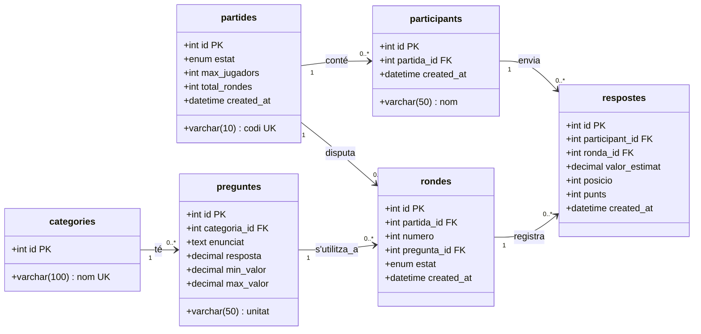

# Documentació de Persistència: How Much?! LIVE

Aquest document descriu el disseny i la implementació de la capa de persistència per al projecte **How Much?! LIVE**, cobrint els requisits **RAD-1** a **RAD-6**.

---

## 1. RAD-1: Model Relacional i Diagrama ER

### Diagrama Entitat-Relació (Notació de Classes)

### Model Relacional

- **categories** (`id` PK, `nom` UNIQUE NOT NULL)
- **preguntes** (`id` PK, `categoria_id` FK -> categories.id RESTRICT, `enunciat` NOT NULL, `resposta` NOT NULL, `unitat` NOT NULL, `min_valor`, `max_valor`, CHECK `min_valor <= max_valor`)
- **partides** (`id` PK, `codi` UNIQUE NOT NULL, `estat` ENUM('esperant','en_curs','acabada'), `max_jugadors` NOT NULL CHECK > 0, `total_rondes` NOT NULL CHECK > 0, `created_at` NOT NULL)
- **participants** (`id` PK, `partida_id` FK -> partides.id CASCADE, `nom` NOT NULL, UNIQUE(`partida_id`, `nom`), `created_at` NOT NULL)
- **rondes** (`id` PK, `partida_id` FK -> partides.id CASCADE, `numero` NOT NULL CHECK > 0, `pregunta_id` FK -> preguntes.id RESTRICT, `estat` ENUM('oberta','tancada'), UNIQUE(`partida_id`, `numero`), `created_at` NOT NULL)
- **respostes** (`id` PK, `participant_id` FK -> participants.id CASCADE, `ronda_id` FK -> rondes.id CASCADE, `valor_estimat` NOT NULL, `posicio`, `punts`, UNIQUE(`participant_id`, `ronda_id`), `created_at` NOT NULL)

---

## 2. Justificació de les Dades Desades

Segons els criteris establerts a l'enunciat:

1. **Que duri més que la ronda, la partida o el procés**:
   - `categories` i `preguntes`: Han de perdurar indefinidament com a banc de preguntes per a futures partides.
   - `partides`, `participants`, `rondes`, `respostes`: Necessàries per consultar l'historial i poder exportar les partides acabades a CSV.
   - `created_at`: Permet ordenar l'historial i netejar partides antigues o abandonades.

2. **Que SQL hi pugui calcular**:
   - Els camps `punts` a `respostes` permeten calcular la classificació acumulada i final de la partida directament mitjançant una consulta amb `JOIN`, `SUM` i `GROUP BY`.
   - El camp `pregunta_id` a `rondes` permet consultar mitjançant una subconsulta quines preguntes NO s'han utilitzat encara en la partida actual (`WHERE id NOT IN (SELECT pregunta_id FROM rondes WHERE partida_id = ?)`).

3. **Que una transacció la pugui bloquejar i comprovar (RAD-4)**:
   - `partides.estat`: Es bloqueja amb `SELECT ... FOR UPDATE` a `unirsePartida` per evitar que nous jugadors entrin quan la partida comença.
   - `rondes.estat`: Es bloqueja amb `SELECT ... FOR UPDATE` a `respondreRonda` per rebutjar respostes que arribin quan la ronda ja s'ha tancat.
   - `respostes`: Es bloquegen i s'actualitzen de manera atòmica a `tancarRonda` juntament amb el canvi d'estat de la ronda a 'tancada'.

### Què NO es desa:
- **Classificacions (acumulada o final)**: Es calculen dinàmicament mitjançant consulta SQL. Desar-les generaria redundància i inconsistències.
- **Estat en temps real (WebSockets, seguiment en viu de votacions)**: Resideix exclusivament a la memòria del servidor Node.js.

---

## 3. RAD-2: Banc de Preguntes amb Sequelize (RA3)

- Configuració a `db/sequelize.js` sense cridar mai `sync()`.
- Models:
  - `Categoria`: camp `nom` amb validació de presència.
  - `Pregunta`: camps `enunciat`, `resposta` (numèric), `unitat`, `min_valor`, `max_valor`.
  - Associació 1:N: `Categoria.hasMany(Pregunta)` i `Pregunta.belongsTo(Categoria)`.
- CRUD implementat a `db/preguntesService.js`:
  - Consultes amb càrrega de relacions (`include: ['preguntes']` o `include: ['categoria']`).
  - Protecció d'integritat: s'impedeix l'esborrat d'una categoria si té preguntes associades llançant un error controlat.
- Rutes REST disponibles a `index.js`: `/api/categories` i `/api/preguntes`.

---

## 4. RAD-3 i RAD-4: Joc i Transaccions amb mysql2 (RA2)

- Pool únic de connexions configurat a `db/mysql.js`.
- Consultes parametritzades amb `?` a `db/jocService.js`.
- Les **tres operacions transaccionals** implementades:
  1. **Unir-se a una partida (concurrència)**:
     - Bloqueig de la fila a `partides` amb `SELECT ... FOR UPDATE`.
     - Comprovació que l'estat sigui `'esperant'` i que no se superi `max_jugadors`.
     - Inserció del participant i `commit` (o `rollback` en cas de sala plena/iniciada).
  2. **Respondre (concurrència)**:
     - Bloqueig de la ronda amb `SELECT ... FOR UPDATE`.
     - Comprovació que l'estat sigui `'oberta'`.
     - Inserció de la resposta (restringit per clau UNIQUE `(participant_id, ronda_id)`) i `commit`.
  3. **Tancar ronda (atomicitat)**:
     - Bloqueig de la ronda amb `SELECT ... FOR UPDATE`.
     - Actualització atòmica dels punts i posicions de tots els participants.
     - Canvi d'estat de la ronda a `'tancada'` i `commit`.
- **Càlcul de rànquing**:
  - Consulta amb `JOIN`, `SUM(r.punts)` i `GROUP BY p.id, p.nom` per calcular la classificació real des de la base de dades.

---

## 5. RAD-5: Persistència en Fitxers JSON i CSV (RA1)

- Mòdul `db/fitxersService.js`:
  - `validarPregunta(pregunta, categoriesMap)`: Retorna `{ valid: boolean, errors: string[] }`.
  - `importarPreguntesJSON(filePath)`: Llegeix amb `fs.promises.readFile`, parseja el JSON en un `try/catch`, valida cada registre i desa les vàlides amb Sequelize informant de les descartades i els motius.
  - `exportarPartidaCSV(partidaId, outputPath)`: Genera amb `csv-stringify` un fitxer estructurat amb la classificació final i el desglossament de respostes i punts de cada ronda.

---

## 6. RAD-6: Capa de Dades i Gestió d'Errors

- Cap controlador HTTP ni gestor de WebSocket executa consultes SQL directes.
- Tots els accessos a dades estan encapsulats a `db/preguntesService.js`, `db/jocService.js` i `db/fitxersService.js`.
- Els errors de claus úniques (`ER_DUP_ENTRY`, `SequelizeUniqueConstraintError`) i claus foranes es capturen de forma centralitzada al middleware d'`index.js` retornant codis i missatges nets.

---

## 7. Desplegament amb Docker Compose

A la carpeta `backend/docker/`:
- `docker-compose.yml`: Defineix els serveis `mariadb`, `servidor` (Node.js) i `nginx`.
- `db/schema.sql`: S'executa automàticament al muntatge `/docker-entrypoint-initdb.d/`.
- `db/dades-inicials.sql`: Carrega les dades inicials per a proves.
